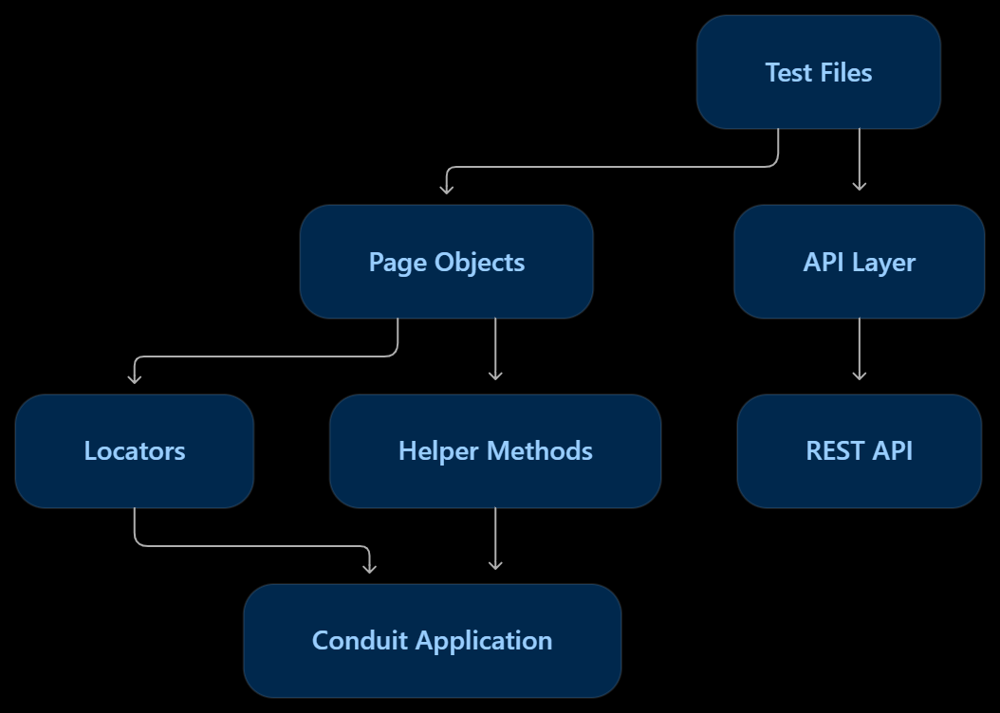

# Conduit Playwright Automation Framework

A Playwright automation framework built with **TypeScript** to test the Conduit application (RealWorld demo). This project demonstrates UI automation, REST API testing, permission validation, reusable test architecture, and CI execution using GitHub Actions.

## Tech Stack

- Playwright
- TypeScript
- Node.js
- REST API testing
- GitHub Actions
- HTML Test Report

## Application Under Test

[Conduit Demo Application](https://conduit.bondaracademy.com)

Conduit is a Medium-style blogging application that supports user registration, authentication, and article management.

## Project Objectives

- Automate end-to-end user workflows.
- Validate article creation, editing, and deletion.
- Verify user-level access restrictions.
- Perform API testing for article CRUD operations.
- Validate important UI elements and page integrity.
- Maintain independent and repeatable tests.
- Execute automated tests through GitHub Actions.

## Test scenarios
| Test Case | Description |
|---|---|
| TC001 – New User | Registers a new user. |
| TC002 – Login | Verifies login functionality using existing user credentials. |
| TC003 – Article Flow | Covers the complete article journey through the UI. |
| TC004 – New Article | Creates a new article and captures its slug. |
| TC005 – Edit Article | Edits an existing article and verifies the updated content. |
| TC006 – Delete Article | Deletes an existing article and verifies its removal. |
| TC007 – Article Permissions | Verifies that a user cannot edit or delete another user's article from API. |
| TC_UI_001 – Home Page UI Integrity | Validates header, footer, navigation, feeds, and important UI elements. Known Issue: This test currently fails because the header is not displayed when the application redirects to the article screen after a successful edit or deletion
| API TC01 – Article CRUD | Validates article creation, retrieval, update, and deletion through REST API requests, including response status and payload verification.|

## Known Issues

### Article Flow: Publish, Edit and Delete fails on the home page UI test

- **Test:** `Regression/TC_UI_001_VerifyHomePageUIIntegrity.spec.ts`: "Verify the Article Flow Publish, Edit and Delete"
- **Browsers affected:** Chromium, Firefox, WebKit
- **Description:** Header section is not displayed when the application redirects to the article screen after a successful edit or deletion
- **Status:** Open
- **Marked as:** `test.fail()` with the ticket ID, so the run stays green while the bug is open


**What this means for test results:** These three tests are expected to fail until the bug is fixed. A pass count of 30 with 3 expected failures is the normal state. The API test for the same flow (`API_TC01_CRUD_Article.spec.ts`) passes on all browsers, so the failure is in the UI only.


## Framework Design

The framework follows a reusable and maintainable structure using:

- Page Object Model (POM) for UI interactions.
- Shared fixtures for reusable test setup.
- API request handling for backend operations.
- Reusable methods for common actions.
- Playwright assertions for validation.
- Web-first assertions to avoid timing issues and flaky tests.
- Environment variables for configuration.



## Installation and Setup

Clone the repository:

```bash
git clone https://github.com/Sujitha-Pauldurai/Conduit_Playwright_Framework.git
```

Navigate to the project:

```bash
cd Conduit_Playwright_Framework
```

Install dependencies:

```bash
npm install
```

Install Playwright browsers:

```bash
npx playwright install
```

## Environment Configuration

Configure the required environment variables before running the tests.

Example:

```env
USERNAME1=
EMAIL1=
PASSWORD1=

USERNAME2=
EMAIL2=
PASSWORD2=

USERNAME3=
EMAIL3=
PASSWORD3=

APIUSERNAME=
APIEMAIL=
APIPASSWORD=

BASEURL=
```

Do not commit actual credentials or `.env` files to GitHub.

## Execution Commands

Run all tests:

```bash
npx playwright test
```

Run tests in headed mode:

```bash
npx playwright test --headed
```

Run a specific test:

```bash
npx playwright test tests/example.spec.ts
```

View the HTML report:

```bash
npx playwright show-report
```

## Continuous Integration

GitHub Actions is configured to execute the Playwright test suite on repository pushes.

The workflow:

- Installs project dependencies.
- Installs Playwright browsers.
- Executes automated tests.
- Generates a Playwright report.
- Uploads the report as a GitHub Actions artifact.

Repository secrets are used to provide credentials and configuration securely.

## Known Limitations

- The project currently targets the public Conduit demo application.
- The demo environment and its API availability are outside the framework's control.


## Future Improvements

With one additional development day, I would:

- Expand negative API and permission scenarios.
- Add stronger test-data cleanup mechanisms.
- Improve CI reporting and failure diagnostics.
- Add cross-browser execution.
- Expand configuration-driven regression coverage for the GSP scenario.

## Author

**QA Engineer | Playwright Automation**

GitHub: [Sujitha-Pauldurai](https://github.com/Sujitha-Pauldurai)